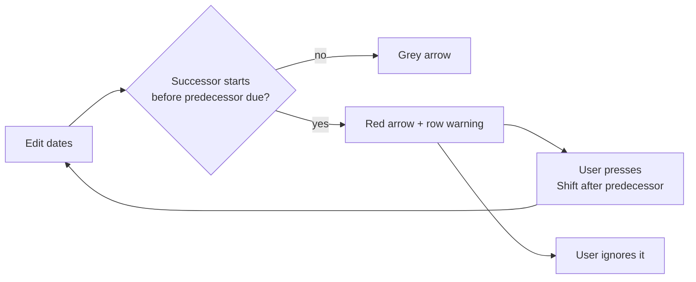
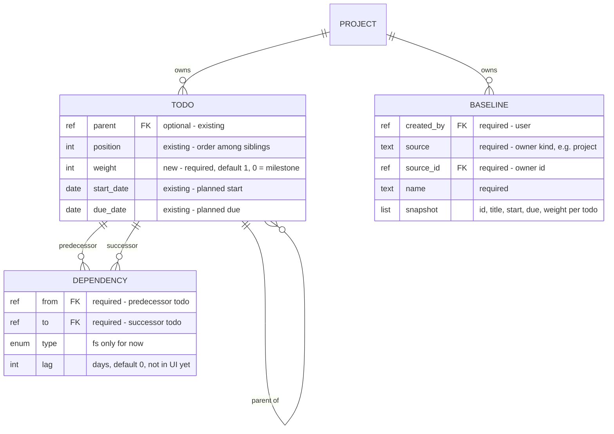

# EAP todos

## Prototypes

All three mockups use one sample project, "Customer portal v2", with today set to Nov 15. The
sample has four phases and 16 todos.

### outline.html

This is the outline view, a fifth view next to Table, Board, Timeline and List. It is a
keyboard-driven tree editor that shows derived WBS codes (`1.2.3`), weighted progress, weights,
and dates. A parent with no dates of its own shows its children's span in italics, marked
"from sub-issues". To try it, click a row and then use the keys in the footer: ↑/↓ to move,
Enter for a new sibling, Tab or Shift+Tab to indent or outdent, Alt+↑/↓ to reorder, F2 to
rename, and Space to mark done. The roll-ups recompute after every edit. "Visual design" warns
that it ends after its parent's due date.

<iframe
  src="./outline.html"
  width="100%"
  height="640"
  style="border:1px solid #ccc;border-radius:8px"
></iframe>

[Open outline.html](./outline.html)

### gantt.html

This is the existing Timeline view drawn with tree rows. Parents get summary brackets, and
arrows show finish-to-start dependencies. Hover a bar to highlight its links, or click an arrow
to remove it. Turn on "Add dependency" and click a predecessor, then a successor. Links that
would create a loop are refused. Two links are in conflict, because the successor starts before
its predecessor is due. Each one shows a warning, and the warning has a "Shift after
predecessor" button. Dates never move unless you press it.

<iframe
  src="./gantt.html"
  width="100%"
  height="680"
  style="border:1px solid #ccc;border-radius:8px"
></iframe>

[Open gantt.html](./gantt.html)

### baseline.html

This mockup compares the plan against a saved baseline. Pick "Kickoff plan" or "After
discovery" to see ghost bars under the live ones and a variance column (`+5d`, `new`,
`removed`). "Save baseline" freezes the current plan, and "Only changes" narrows the rows to the
ones that moved.

<iframe
  src="./baseline.html"
  width="100%"
  height="680"
  style="border:1px solid #ccc;border-radius:8px"
></iframe>

[Open baseline.html](./baseline.html)

## Overview

Todos already nest: a sub-issue has a parent and a manual position. A project, though, is
planned as a work breakdown (the EAP in fpe-erp), and that needs more:

- the whole tree read at once
- progress that rolls up by weight, not by count
- parent dates that follow their children
- an editor where the outline is shaped from the keyboard
- dependencies between todos
- a frozen plan to measure slippage against

Today the table builds its tree in the browser from one page of at most 100 rows, so parent
counts are wrong on bigger projects.

This feature keeps the todo as the only unit. There are no phase, package or activity types.
A phase is a todo with children, and a milestone is a todo with weight 0 and only a due date.
The shape follows fpe-erp:

- codes are derived, never stored
- roll-ups are one bottom-up pass
- dependencies are explicit edges with a cycle check
- baselines are immutable snapshots

Three things are left out on purpose:

- money-valued weights
- business-day calendars
- automatic scheduling (fpe-erp pushes successors; here a conflict only warns)

## Features

**Tree read and roll-ups (every project view)**

- A project's todos load as one tree in outline order, with nothing paged out, so counts and
  progress are right at any size.
- Every parent shows:
  - `done/total` over its whole subtree
  - weighted progress
  - the earliest start and latest due beneath it
- WBS codes (`2.3`, `3.1.2`) are derived from position on every read. Indenting or reordering
  renumbers the rows on screen. Nothing is stored.
- Filters (status, assignee, stage, search) keep any ancestor of a match on screen, dimmed, so a
  match never loses its context.

**Weight and progress**

- Each todo has a whole-number weight, default 1. A weight of 0 makes a milestone, which is
  counted but adds nothing to progress.
- A leaf's progress is 100% when done and 0% otherwise. A parent's progress is the weighted mean
  of its children, all the way up.
- A todo closed as `not_planned` drops out of its parent's denominator.

**Parent dates**

- A parent with no dates of its own shows its children's span, in italics, marked "from
  sub-issues".
- A parent with its own dates keeps them. A child running past them gets a warning, and nothing
  is blocked.

**Outline view**

| Key                | Action                                                              |
| ------------------ | ------------------------------------------------------------------- |
| ↑ / ↓              | Move focus                                                          |
| ← / →              | Collapse or expand, or jump to the parent                           |
| Enter              | New sibling below, title in edit mode                               |
| Tab / Shift+Tab    | Indent under the sibling above / outdent to after the parent        |
| Alt+↑ / Alt+↓      | Reorder among siblings                                              |
| F2 or double-click | Rename inline (Enter commits, Esc cancels)                          |
| Space              | Toggle done                                                         |
| Delete             | Remove; its children move up into its place (the current behaviour) |
| `.`                | Row menu (U6)                                                       |

- Each edit saves right away. The row shows the new value with a `Status` dot while the
  call runs, following the `Inline` rule, and reverts if the call fails.

**Dependencies and Gantt**

- Dependencies are finish-to-start only: "B can start once A is due".
- They are drawn as arrows on the Timeline once it shows tree rows.
- Add one in either of two ways:
  - "Add dependency" mode, then click the predecessor and the successor
  - from the todo's detail page, through a "Blocked by" picker whose options come from the
    server
- Both todos must belong to the same project, and neither can sit above the other in the
  tree. A link that would create a loop is refused, and the error names the loop.
- A conflict (the successor starts before its predecessor is due) shows as a red arrow and a
  warning on the row. "Shift after predecessor" moves the successor and keeps its duration.
  Nothing moves on its own.

**Baselines**

- "Save baseline" snapshots the planned start, due and weight of every todo in the project,
  under a name. Parents are saved with their derived span.
- A baseline picker in the Timeline toolbar draws one baseline as ghost bars and adds a
  variance column: days between the baseline due and the current due, with `new` and
  `removed` badges.
- A summary strip, for example "8 slipped · 3 on plan · 1 new · 1 removed · Go-live +5d", and an
  "Only changes" toggle.
- Baselines are immutable. They can be deleted but never edited.

**Agent (MCP)**

- The assistant can:
  - read the tree with its roll-ups
  - add and remove dependencies
  - save a baseline and read what changed since one
- Weight is set through the existing update tool.

> [!NOTE]
> Should the project-scoped Table view switch to the tree read too, so its counts are right?
> Recommended: yes. The home `/todos` list spans projects, so it stays paged and keeps the
> client-side tree.

> [!NOTE]
> Should dependency lag (for example "+2 days after") ship with finish-to-start? Recommended:
> store a `lag` column now, defaulting to 0, but leave it out of the UI until someone asks.
> That avoids a second migration.

## Data model

Every table carries the shared columns: `id`, `time_created`, `time_updated` and
`time_deleted`. Only the new fields and entities appear below. `TODO` already has `parent`,
`position`, the planned dates and the actual dates.

- **Derived on every read, never stored:**
  - WBS code
  - depth
  - `done/total`
  - weighted progress
  - a parent's span when it has no dates of its own
  - conflict warnings
  - baseline variance
- **Each dependency link is unique per pair of todos.** Removing a todo removes its links.
  Links never cross projects.
- **A baseline's snapshot is written once.** Todos deleted later still show from the snapshot as
  `removed`.

Full schema, the ops, endpoints and phases live in [PLAN.md](./PLAN.md).

## Out of scope

- Automatic scheduling or pushing successors (fpe-erp's `empurrar`), and critical path or CPM
- Start-to-start, finish-to-finish and start-to-finish links (the column allows them later)
- Business-day calendars and holidays. Durations are calendar days.
- Money or quantity as weight, and a manually entered progress percentage
- Cross-project dependencies, and a tree on the cross-project `/todos` home
- Drag to reorder in the outline (the keyboard and the row menu cover it)
