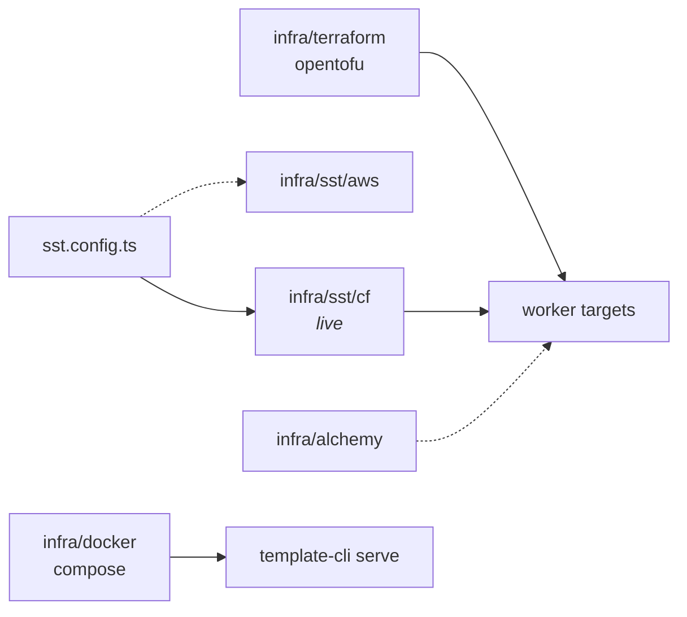

# Runtime

## One request

Every service is a plain Hono app. The _target_ wraps it with a database connection and
whatever else the environment provides; the app itself never knows where it runs.

```mermaid
sequenceDiagram
  participant C as Caller
  participant T as target (bun/lambda/worker)
  participant M as middleware
  participant H as handler
  participant Core as core

  C->>T: request
  T->>M: inside Database context
  M->>M: resolve identity<br/>(bearer: sk-, agt- or JWT; else public)
  M->>H: Identity.enter(...)
  H->>Core: one call, validated by fn()
  Core-->>H: result
  H-->>C: JSON / VisibleError
```

Two rules fall out of this. Handlers stay thin — validate, call one core function, return.
And core never reads a header: everything it needs about the caller comes from `Identity`.

## Targets

`packages/functions/src/target.ts` has one function per environment, and each service has
a `target/` directory that picks one:

| Target   | Database                          | Used by                                            |
| -------- | --------------------------------- | -------------------------------------------------- |
| `bun`    | One pool per process              | `bun dev`                                          |
| `lambda` | Pool from env, streamed responses | `infra/sst/aws` (not the queue)                    |
| `worker` | Fresh pool per request            | `infra/sst/cf`, `infra/terraform` (via Hyperdrive) |

A `bun` pool holds 10 connections. Docker runs none of these: its services go through
`template-cli serve <api|mcp|auth|dashboard>` (`apps/cli/src/serve.ts`), which wires the
same providers as the `bun` targets.

The dashboard is not a functions target. `SVELTE_ADAPTER` picks its build: `node` (default,
Docker and e2e), `bun`, or `cloudflare` (the Workers paths, bindings via `cloudflare:workers`).

The worker's per-request pool isn't an oversight — Workers forbid reusing a socket across
requests, so `worker()` closes it once the response body is sent.

## Deploy



`sst.config.ts` imports `infra/sst/cf`; `infra/sst/aws` is the alternate wiring. Its dashboard
has no adapter: `svelte-kit-sst` has no SvelteKit 3 release (sst/sst#6993).
`infra/terraform` deploys the same Cloudflare stack as `infra/sst/cf` without SST — it has
its own state and its own `tf.` domain, so the two can coexist. `infra/alchemy` is a
third, alternate wiring. `infra/docker` runs one app image under Compose: every service
is a `template-cli serve` target, and a one-shot `migrate` service runs `template-cli db
migrate` (core's `Migrations.apply`, under Bun) before the rest start.

**Agents never deploy.** No `sst deploy`, no `sst remove`, no infra-mutating command —
prepare the change and hand the command to the user.

## Local stack

`bun dev` runs everything. `DB=pglite` keeps Postgres in-process, `RESET=1` wipes it. Names,
ports and flags: [`scripts/AGENTS.md`](../scripts/AGENTS.md).
