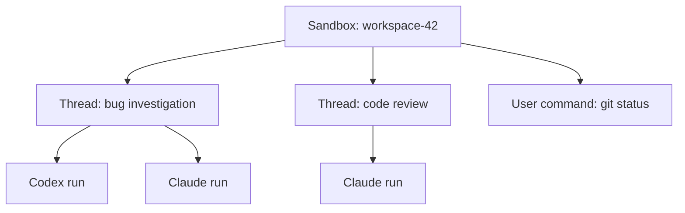

# `@template/agent`

`@template/agent` provides thin composition helpers around TanStack AI. Application code keeps the
native TanStack shape: `chat()`, adapters, middleware, sandbox definitions, and sandbox handles stay
visible.

## Principles

1. Keep TanStack transparent; do not recreate its runtime contracts.
2. A sandbox owns compute and a reusable workspace, not a harness.
3. Many independent chat threads and harnesses can use one sandbox.
4. Harness credentials are scoped to the selected process.
5. Applications authorize sandbox access before constructing or attaching it.
6. Docker and Cloudflare imports remain isolated in provider subpaths.

## Concepts

```text
Workspace   Repository source and explicit setup commands
Sandbox     One concrete reusable workspace/container
Harness     Claude Code or Codex, selected for each run
Thread      Independent application chat history
Run         One harness invocation in a thread
```



Every run sees the same files in `workspace-42`; each thread keeps its own message history.

## Public API

```text
@template/agent
  AgentContext
  Model.list
  Model.text

@template/agent/sandbox
  Workspace.make
  Workspace.github
  Workspace.local
  Sandbox.make
  Sandbox.ensure
  Sandbox.attach
  Sandbox.destroy
  Harness.Claude
  Harness.Codex

@template/agent/docker
  Docker.make

@template/agent/cloudflare
  Cloudflare.make
  Cloudflare.agent
```

The helpers return TanStack-compatible values.

## Workspace

`Workspace.make` is `defineWorkspace`, and the source helpers map directly to TanStack helpers.
There is no package-manager or install-command inference.

```ts
import { Workspace } from "@template/agent/sandbox";

const workspace = Workspace.make({
  source: Workspace.github({
    repo: "owner/buggy-app",
    ref: "dev",
  }),
  setup: ["bun install --frozen-lockfile"],
});
```

Local development can use:

```ts
const workspace = Workspace.make({
  source: Workspace.local("/home/user/project"),
  setup: ["bun install --frozen-lockfile"],
});
```

The workspace contains no inference credentials.

## Sandbox

A sandbox is one concrete reusable workspace. Its `id` is the application-owned identity used to
find the same provider instance across chat threads.

```ts
import { Sandbox } from "@template/agent/sandbox";
import { Docker } from "@template/agent/docker";

const sandbox = Sandbox.make({
  id: "workspace-42",
  tenant: {
    userId,
  },
  provider: Docker.make({
    image: "template/agent:latest",
  }),
  workspace,
  lifecycle: {
    snapshot: "after-setup",
    keepAlive: "30m",
  },
});
```

There is no separate `kind` or session object. Provider, workspace, and lifecycle are the behavior;
`id` and tenant identify the concrete sandbox.

TanStack normally keys reusable sandboxes by `threadId`. `Sandbox.make` scopes its returned native
`SandboxDefinition` by:

```text
tenant + sandbox.id + provider + workspace
```

That allows different chat threads to share one sandbox without sharing conversation history. A
user-controlled ID is not authorization: the application must verify access before constructing the
sandbox. Tenant scoping prevents equal IDs from colliding across users or organizations.

## Harnesses

Harnesses are selected per run and return native TanStack text adapters.

### Claude Code

```ts
const adapter = Harness.Claude(config, {
  model: "coding-claude",
  maxTurns: 30,
  permissionMode: "bypassPermissions",
  settingSources: ["project"],
});
```

`Harness.Claude` injects only the selected Claude LiteLLM credential into the Claude process:

```text
ANTHROPIC_BASE_URL
ANTHROPIC_AUTH_TOKEN
ENABLE_TOOL_SEARCH=true
```

### Codex

```ts
const adapter = Harness.Codex(config, {
  model: "coding-codex",
  approvalPolicy: "never",
  sandboxMode: "workspace-write",
});
```

`Harness.Codex` injects only `CODEX_API_KEY` and configures the CLI to use LiteLLM:

```toml
model_provider = "litellm"

[model_providers.litellm]
name = "LiteLLM"
base_url = "https://llm.example.com/v1"
env_key = "CODEX_API_KEY"
wire_api = "responses"
```

The LiteLLM deployment must expose the OpenAI-compatible Responses API.

## Transparent Docker execution

```ts
import { chat, memoryStream, toServerSentEventsResponse } from "@tanstack/ai";
import { withLocks } from "@tanstack/ai/locks";
import { withPersistence } from "@tanstack/ai-persistence";
import { withSandbox } from "@tanstack/ai-sandbox";
import { AgentContext } from "@template/agent";
import { Harness } from "@template/agent/sandbox";

const config = await AgentContext.use().resolve({
  profile: "codex",
  thread: input.thread,
});
const delivery = memoryStream(input.request);

const stream = chat({
  adapter: Harness.Codex(config, {
    model: "coding-codex",
  }),
  messages: input.messages,
  threadId: input.thread,
  runId: input.run,
  middleware: [
    withPersistence(stores.persistence),
    withLocks(stores.locks),
    withSandbox(sandbox, {
      runs: stores.persistence.stores.runs,
      instances: stores.instances,
      durability: { adapter: delivery },
    }),
  ],
});

return toServerSentEventsResponse(stream, {
  durability: { adapter: delivery },
});
```

A Claude run in the same sandbox changes only the adapter and may use another thread:

```ts
const stream = chat({
  adapter: Harness.Claude(config, {
    model: "coding-claude",
    maxTurns: 30,
  }),
  messages,
  threadId: "code-review",
  runId,
  middleware: [withSandbox(sandbox, options)],
});
```

## User-driven commands

Attach to a running sandbox without starting a model:

```ts
const handle = await Sandbox.attach(sandbox, {
  runId: "command-01",
  instances: stores.instances,
  locks: stores.locks,
});

if (!handle) throw new Error("Sandbox is not running");

const status = await handle.git.status();
const tests = await handle.process.exec("bun test");

await handle.git.add(["."]);
await handle.git.commit("Fix failing tests");
```

`handle` is TanStack's native `SandboxHandle`; `git`, `process`, `fs`, `ports`, and `env` are not
wrapped.

A public HTTP API should usually expose allowlisted operations instead of arbitrary commands:

```ts
const commands = {
  status: () => handle.git.status(),
  test: () => handle.process.exec("bun test"),
  commit: (message: string) => handle.git.commit(message),
};
```

## Cloudflare

The Cloudflare container image contains both Claude Code and Codex. Each run selects a harness while
the sandbox ID selects the shared workspace.

```ts
import { Cloudflare } from "@template/agent/cloudflare";
import { Harness, Sandbox, Workspace } from "@template/agent/sandbox";

const agent = Cloudflare.agent<Env>({
  adapter(input, env) {
    const config = resolveConfig(env, input);
    const model = required(input.metadata, "model");

    if (input.metadata?.harness === "claude") {
      return Harness.Claude(config, { model });
    }
    return Harness.Codex(config, { model });
  },
  sandbox(input, env) {
    return Sandbox.make({
      id: required(input.metadata, "sandbox"),
      tenant: { userId: required(input.metadata, "userId") },
      provider: Cloudflare.make({ binding: env.Sandbox }),
      workspace: Workspace.make({
        source: Workspace.github({
          repo: required(input.metadata, "repo"),
          ref: optional(input.metadata, "ref"),
        }),
      }),
      lifecycle: { keepAlive: "30m" },
    });
  },
  stallTimeoutMs: 10 * 60_000,
});

export const RunCoordinator = agent.Coordinator;
export const SandboxContainer = agent.Sandbox;
export default agent.worker;
```

Codex request:

```json
{
  "threadId": "bug-investigation",
  "messages": [{ "role": "user", "content": "Fix the failing tests." }],
  "metadata": {
    "sandbox": "workspace-42",
    "userId": "user-01",
    "harness": "codex",
    "model": "coding-codex",
    "repo": "owner/buggy-app",
    "ref": "dev"
  }
}
```

Claude can review the same files using another thread and the same sandbox ID:

```json
{
  "threadId": "code-review",
  "messages": [{ "role": "user", "content": "Review the Codex changes." }],
  "metadata": {
    "sandbox": "workspace-42",
    "userId": "user-01",
    "harness": "claude",
    "model": "coding-claude",
    "repo": "owner/buggy-app",
    "ref": "dev"
  }
}
```

Cloudflare's Durable Object log keeps each run independent even though the files are shared.
Cancellation must destroy the Cloudflare container because its provider cannot signal the process.

## Normal assistants

Normal assistants use the contextual model port and do not depend on sandbox concepts:

```ts
import { Model } from "@template/agent";

const stream = chat({
  adapter: Model.text(input.model),
  messages: input.messages,
  tools,
  middleware,
});
```

A deployment or request can replace the model implementation:

```ts
await Model.provide(litellm(config), () => orchestrator(input));
```

## Concurrency

TanStack's sandbox lock prevents duplicate instance creation. It does not serialize every command or
model run after creation. Two write-capable harnesses can overwrite each other when they edit the
same checkout concurrently.

Recommended initial application policy:

- one write-capable harness run or user command per sandbox
- return `409 Sandbox busy` instead of silently queueing
- key the operation lock by tenant and sandbox ID
- hold it for the complete harness run, including detached execution
- optionally allow concurrent read-only operations later

## Harness resume IDs

Workspace identity, application threads, and CLI conversational state remain different:

1. `sandbox.id` selects the shared files and provider instance.
2. `threadId` selects application conversation history and durable runs.
3. Claude Code and Codex emit their own resume IDs.

Harness resume IDs should be persisted by `(tenant, sandbox ID, thread ID, harness)`. Switching a
thread from Codex to Claude shares files but starts or resumes a different CLI conversation.

## Implementation mapping

| Public helper      | TanStack implementation                           |
| ------------------ | ------------------------------------------------- |
| `Workspace.make`   | `defineWorkspace`                                 |
| `Workspace.github` | `githubRepo`                                      |
| `Workspace.local`  | `localSource`                                     |
| `Docker.make`      | `dockerSandbox`                                   |
| `Cloudflare.make`  | `cloudflareSandbox`                               |
| `Cloudflare.agent` | `createCloudflareSandboxAgent`                    |
| `Sandbox.make`     | `defineSandbox` with a sandbox-ID lifecycle scope |
| `Sandbox.ensure`   | `SandboxDefinition.ensure`                        |
| `Sandbox.attach`   | `SandboxDefinition.ensureExisting`                |
| `Sandbox.destroy`  | `SandboxDefinition.destroy`                       |
| `Harness.Claude`   | `claudeCodeText`                                  |
| `Harness.Codex`    | `codexText`                                       |
| Durable runs       | `withPersistence`, `withLocks`, `withSandbox`     |

## Remaining production work

1. Shared run, sandbox-instance, lock, and delivery stores for Docker replicas.
2. Takeover, cancellation, active-run lookup, and scheduled reaping routes.
3. A sandbox operation lock covering detached write runs.
4. Persistence and forwarding of Claude Code and Codex resume IDs.
5. Product authorization for sandbox construction and command attachment.
6. Product APIs for allowlisted commands, commits, pushes, previews, and file downloads.
